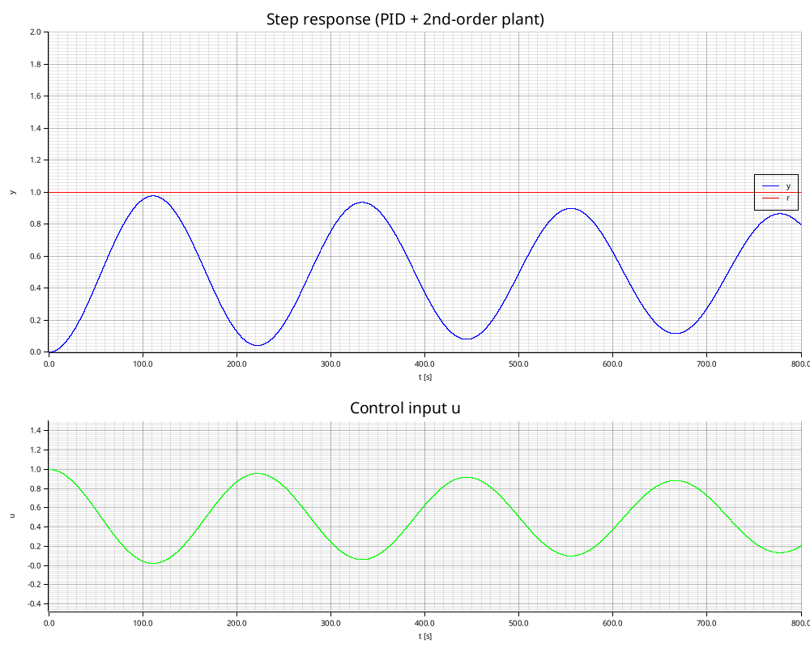
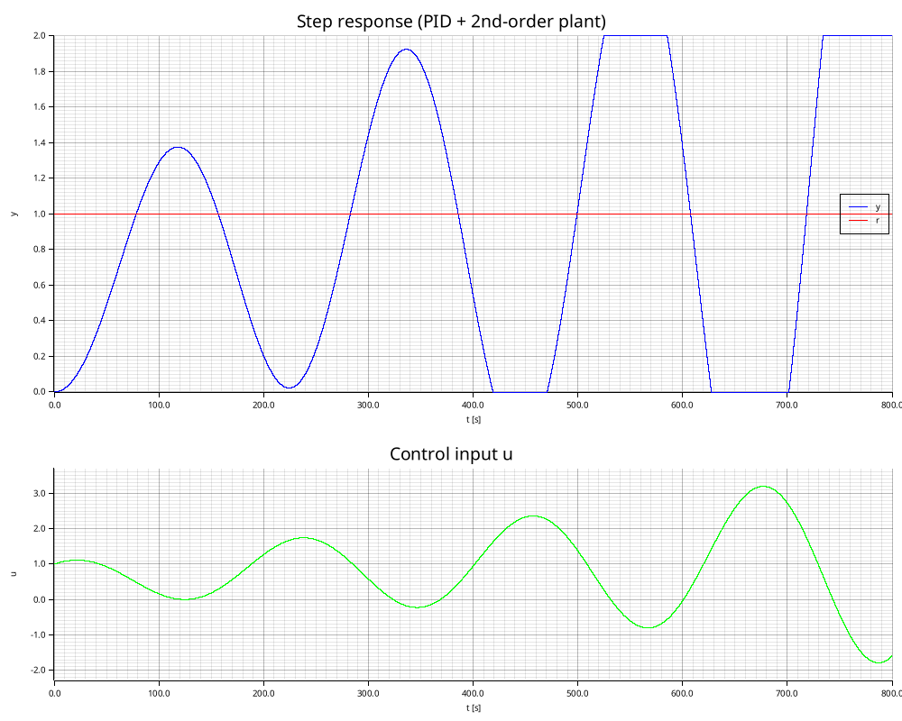
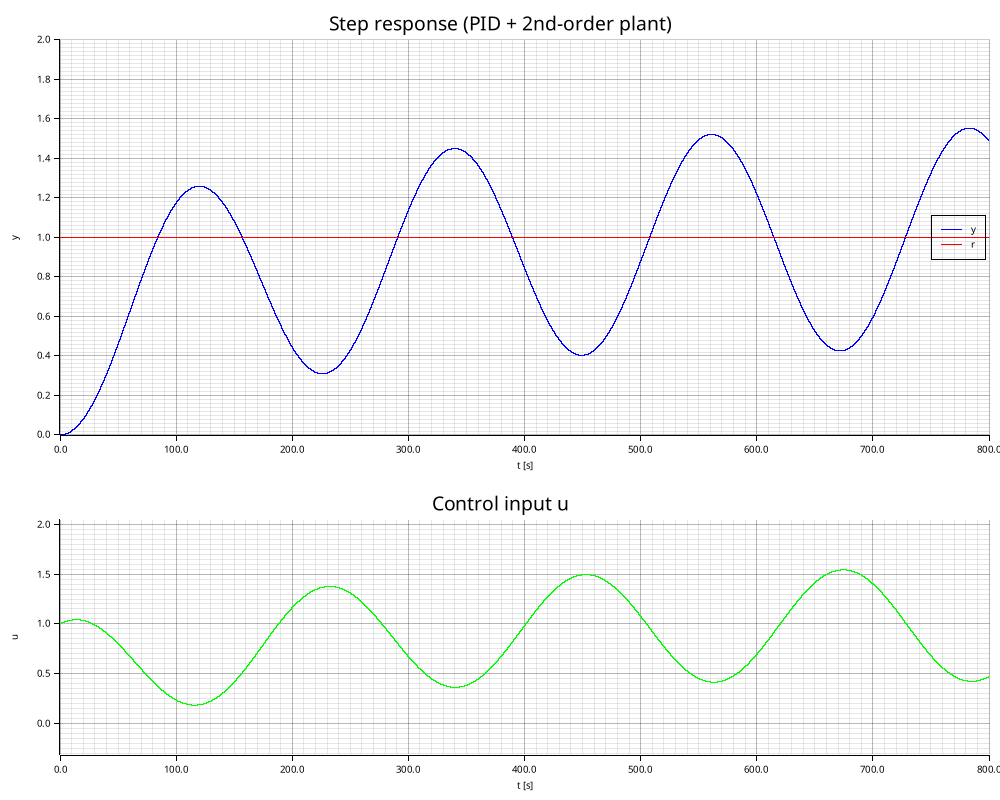
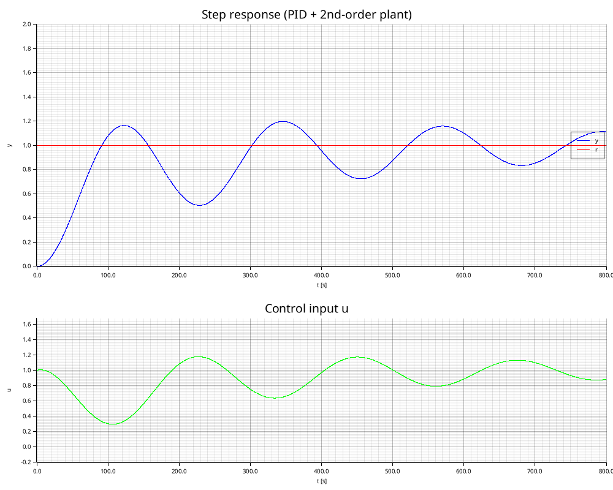
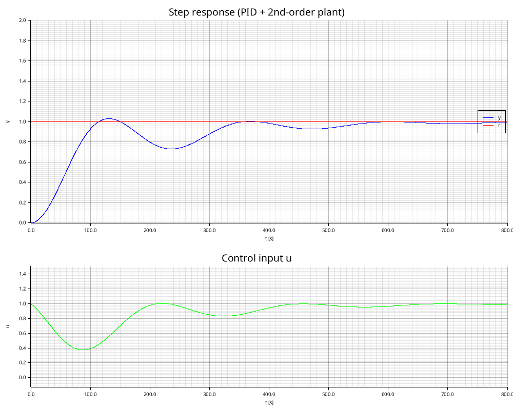
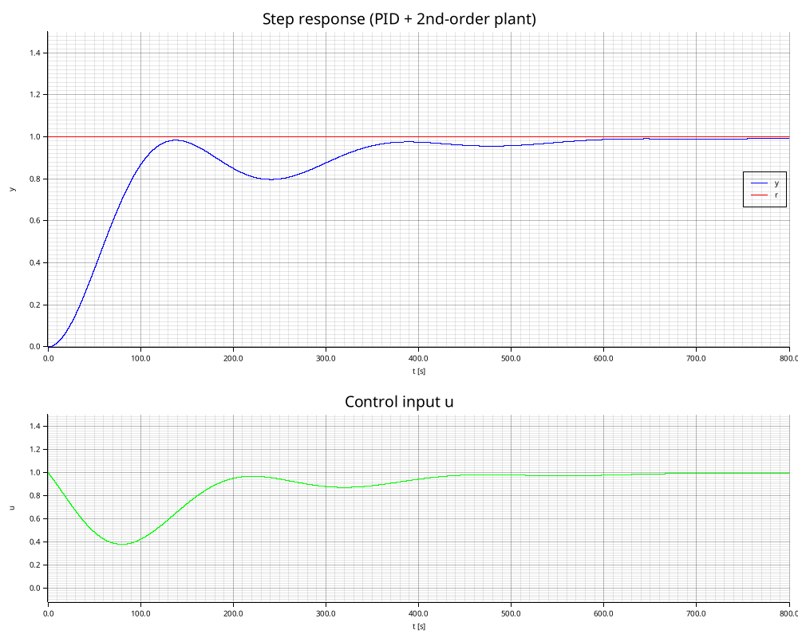
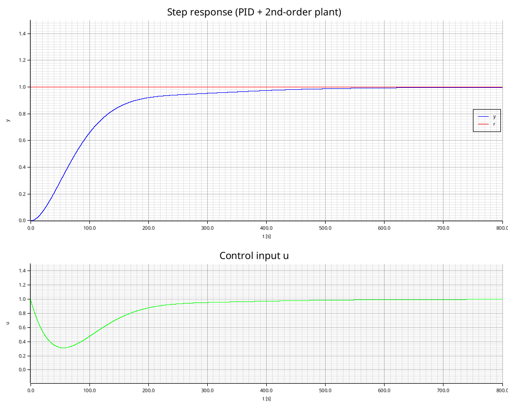
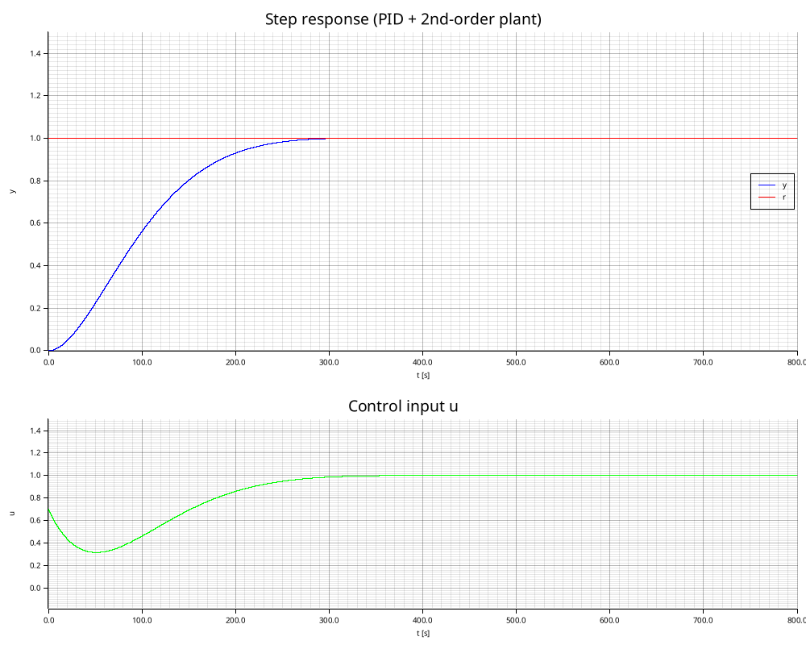

# pid_sim
PID control simulation for second-order system

#### Kp=1 Ki=0 Kd=0

#### Kp=1 Ki=0.01 Kd=0

#### Kp=1 Ki=0.01 Kd=10

#### Kp=1 Ki=0.01 Kd=20

#### Kp=1 Ki=0.01 Kd=40

#### Kp=1 Ki=0.01 Kd=50

#### Kp=1 Ki=0.01 Kd=100

#### Kp=0.7 Ki=0.01 Kd=100

